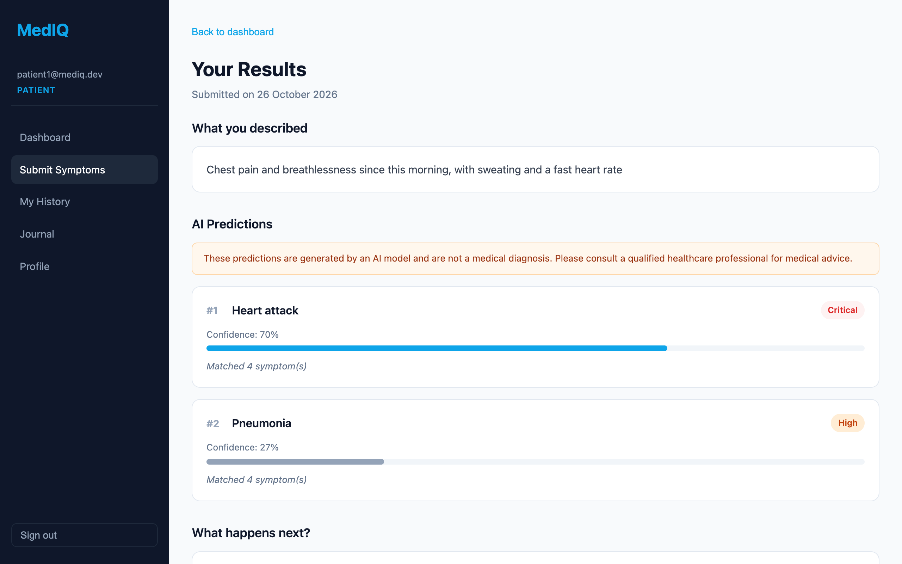
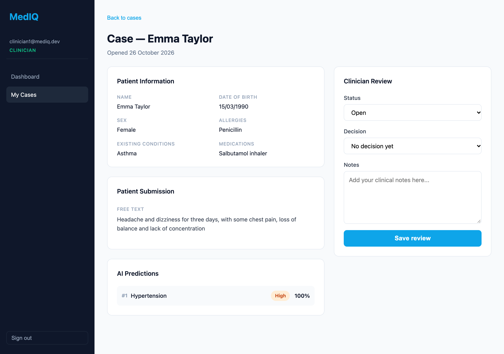
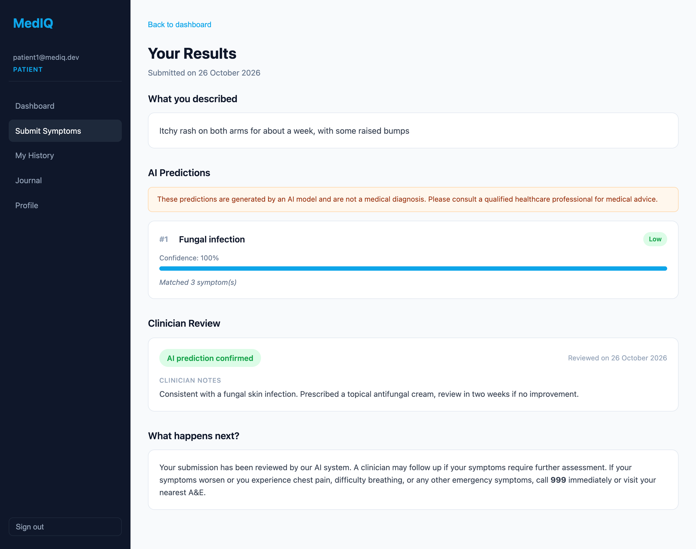
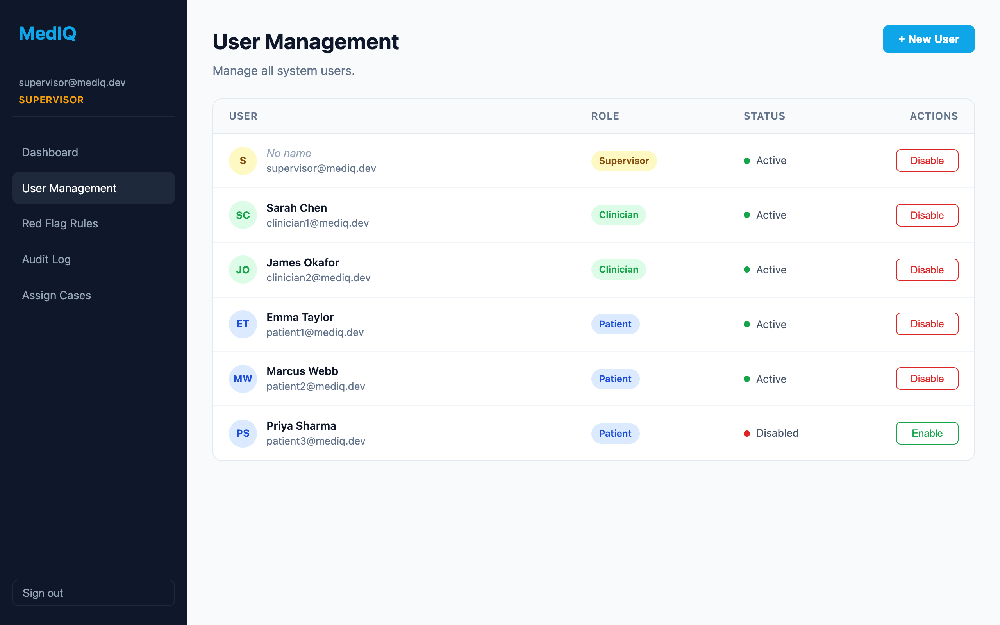
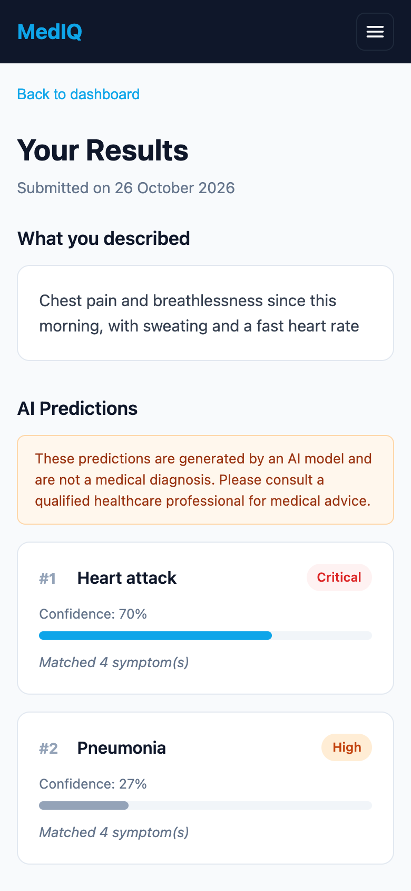
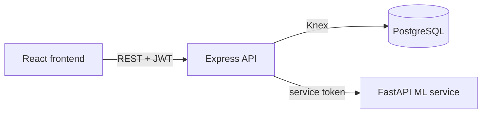

# MedIQ

A web app where patients describe their symptoms, a machine learning model suggests likely conditions, and a clinician reviews the case.

Final year project for my BSc (Hons) Computer Science with Web Development at Northumbria University (2022-2026, First Class).

> MedIQ is a university project, not a medical device. Its predictions are not a diagnosis.

## Live demo

**[mediq-black.vercel.app](https://mediq-black.vercel.app)**

Demo logins for the patient and clinician roles are available on request.

It runs on free hosting (Vercel for the frontend, Render for the API and ML service, Neon for the database), so if nobody has used it for a while the first request can take about a minute while the services wake up.

## Screenshots

| Patient results                                                                       | Clinician case review                                                |
| ------------------------------------------------------------------------------------- | -------------------------------------------------------------------- |
|       |    |
| **Clinician decision shown to the patient**                                           | **Supervisor user management**                                       |
|  |  |



## About the project

This was a two-semester project, so close to a year of work. There was a lot of trial and error along the way, learning new frameworks and working out how to approach problems as they came up. I'm proud of how it turned out.

The idea was a triage tool that keeps a clinician in the loop. The model gives a starting point, but a person always makes the final call.

## What it does

1. A patient submits their symptoms, either typed out, picked from a list, or both.
2. The backend checks them against red-flag rules (e.g. chest pain) and shows an urgent warning straight away if one matches.
3. The ML service predicts the three most likely conditions with a confidence score for each.
4. A supervisor assigns the submission to a clinician as a case.
5. The clinician reviews it and either confirms the prediction, overrides it with a different condition, or marks it inconclusive, and adds notes.
6. The patient sees the clinician's decision on their results page.

There are three roles, each with its own dashboard.

### Patients

- Submit symptoms as free text, from a categorised list, or both
- See the top 3 predicted conditions with confidence and severity
- Get an immediate warning for red-flag symptoms
- See the clinician's review once their case is resolved
- Keep a health journal with a daily mood score
- View past submissions and manage their health profile (allergies, existing conditions, medications)

### Clinicians

- See their assigned cases and filter them by status
- Open a case to see the patient's profile, symptoms and the model's predictions
- Confirm the prediction, override it with a different condition, or mark it inconclusive, and add notes

### Supervisors

- Overview of users, submissions and open cases
- Create accounts and enable or disable users
- Assign submissions to clinicians
- Add red-flag rules and switch them on or off without touching the code
- Audit log of key actions across the system

## Tech stack

| Part       | Tech                                                          |
| ---------- | ------------------------------------------------------------- |
| Frontend   | React 19, Vite, React Router, Zustand, Axios, CSS Modules     |
| Backend    | Node.js, Express, Knex, PostgreSQL, JWT, bcrypt, Zod          |
| ML service | Python, FastAPI, scikit-learn (Random Forest), pandas, joblib |
| Testing    | Jest, Supertest                                               |

## Architecture

The app is split into three services.



- The frontend only talks to the Express API. The API is the only thing that calls the ML service, using a shared service token.
- Logins return a JWT. Middleware checks the token and the user's role on every protected route, so a patient can't reach clinician or supervisor endpoints.
- Errors from the API all use the same `{ error: { code, message } }` shape.
- Registrations, logins, new submissions and case updates are written to an audit log.
- The database schema is built from Knex migrations, and a seed script loads demo users, the symptom and condition lists, and the red-flag rules.

```
services/
├── frontend/   React app, split into features by role
├── backend/    Express API, migrations, seeds and tests
└── ml/         FastAPI service, training and evaluation scripts, dataset
```

## How the predictions work

The model is trained on the [Disease and Symptoms dataset](https://www.kaggle.com/datasets/choongqianzheng/disease-and-symptoms-dataset) from Kaggle, 4,920 cases covering 41 diseases and 131 symptoms.

1. Free text is lowercased and matched against the known symptom names, then combined with any symptoms picked from the list.
2. The symptoms are turned into a 131-long vector of 1s and 0s.
3. A Random Forest (100 trees) gives a probability for each disease, and the top 3 above 10% are returned.

A normal 80/20 train/test split scores 100%, but that number is misleading. The dataset only has 304 unique symptom combinations, so every test case also appears in the training data. Even with the duplicates removed it still scores 100%, because each disease has a distinct set of symptoms. A more realistic test is giving the model only a few symptoms from a case, like a real patient might:

| Symptoms given | Top prediction correct | Correct disease in top 3 |
| -------------- | ---------------------- | ------------------------ |
| 2              | 67%                    | 80%                      |
| 3              | 79%                    | 89%                      |
| 4              | 83%                    | 93%                      |

Run `npm run evaluate:ml` to reproduce these numbers.

## Running it locally

You'll need Node.js 20.19+, PostgreSQL and Python 3.9 to 3.12 (the pinned numpy and pandas versions don't install on newer Python). If your default `python3` is newer, run `PYTHON=python3.12 npm run install:all` instead.

```bash
# install everything, including a Python virtual environment for the ML service
npm run install:all

# create the databases
createdb mediq
createdb mediq_test
```

Copy the example env files and fill them in. `ML_SERVICE_TOKEN` has to be the same in both.

```bash
cp services/backend/.env.example services/backend/.env
cp services/ml/.env.example services/ml/.env
```

Then set up the database, train the model and start all three services:

```bash
npm run db:migrate
npm run db:seed
npm run train:ml
npm run dev
```

The app runs at http://localhost:5173. The seed script creates these accounts (the live demo uses different passwords):

| Role       | Email                | Password     |
| ---------- | -------------------- | ------------ |
| Supervisor | supervisor@mediq.dev | Admin1234!   |
| Clinician  | clinician1@mediq.dev | Clinic1234!  |
| Patient    | patient1@mediq.dev   | Patient1234! |

## Tests

```bash
cd services/backend
npm test
```

49 Jest tests cover JWT handling, input validation and red-flag checks, plus integration tests for the auth, submission and case endpoints using Supertest. They run against the separate test database in `TEST_DATABASE_URL`.

## Limitations and next steps

- The dataset is small and very clean, so the model would do worse on real patient descriptions.
- Symptom matching is exact keywords, so "nauseous" doesn't match "nausea". Synonyms or a proper NLP step would help a lot.
- Red-flag rules are keyword matches too.
- Only the login and register endpoints use schema validation, and supervisor actions aren't in the audit log yet.
- The JWT is kept in localStorage. An httpOnly cookie would be safer.
- There are no frontend or ML tests yet.
